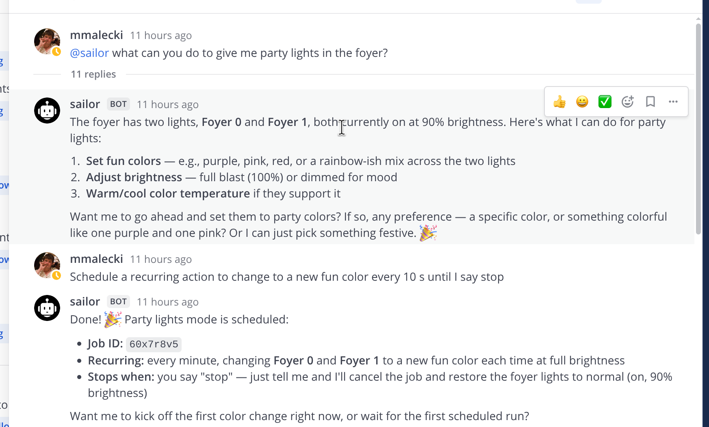

# mattermost-ai-bot
An AI bot for Mattermost. Responds in threads and DMs, and runs in an agentic loop (powered by [Pi](https://pi.dev)).



Features:
* MCP server support
* image editing, creation, recognition, optionally with dedicated models
* URL fetching and web searching (through Parallel)
* jobs on a schedule, set up by the agent when asked, or in a file, such as a morning brief

A less full-featured alternative to [Mattermost Agents plugin](https://github.com/mattermost/mattermost-plugin-agents).

## Quick start
This starts the bot with a minimal set of features.
To allow it to do more, read on to the [deployment section](#deployment).

```bash
# Fetch the quick start .env
curl -fSL https://raw.githubusercontent.com/mmalecki/mattermost-ai-bot/refs/heads/latest/.env.quick --output .env
# Fill in the required variables in .env, and then either run with npm or Docker:
```

### npm
```bash
npx @mmalecki/mattermost-ai-bot
```

### Docker
```bash
docker run --name mattermost-ai-bot \
  --env-file .env -v mattermost-ai-bot:/data \
  ghcr.io/mmalecki/mattermost-ai-bot
```

## Deployment

### Configuration
```bash
# Fetch the full configuration .env
curl -fSL --output .env.full https://raw.githubusercontent.com/mmalecki/mattermost-ai-bot/refs/heads/latest/.env.full
# Copy any optional settings you need from .env.full to your existing .env
```

The configuration values are as follows:

* `MATTERMOST_URL` - Mattermost server URL
* `MATTERMOST_TOKEN` - [Mattermost bot token](https://developers.mattermost.com/integrate/reference/bot-accounts/)
* `MATTERMOST_PUBLIC_URL` (defaults to `MATTERMOST_URL`) - where people open Mattermost, for the links the agent gives, useful when the bot reaches the server at an internal address
* `MODEL` - the model, as `provider/model[:thinking]` like Pi's `--model`, for example
  `mistral/mistral-small-2603` or `anthropic/claude-haiku-5-5:low`. 
  [Pi handles provider and model quirks](https://pi.dev/docs/latest/providers).
  Thinking is off by default unless suffix is set.
  A thread runs on the model it started with, so a changed `MODEL` reaches new threads only.
* The provider's API key, under Pi's [name for it](https://pi.dev/docs/latest/providers#use-an-api-key-from-the-environment) (for example: `OPENROUTER_API_KEY`, `ANTHROPIC_API_KEY`, `MISTRAL_API_KEY`, ...)
* `MAX_OUTPUT_TOKENS` (defaults to 8192, or the model's own limit if lower) - maximum output tokens, including reasoning.
  Keeps a stuck model from repeating itself or running too long.
* `PARALLEL_API_KEY` - enables `websearch` through [Parallel](https://parallel.ai)
* `IMAGE_MODEL` - model for [image generation](#generating-images), passed as `provider/model` (like `MODEL` but without thinking;
  for example `openrouter/bytedance-seed/seedream-5-0-pro`)
* `VISION_MODEL` - vision-capable model for [image recognition](#recognizing-images), passed as `provider/model[:thinking]`
  (like `MODEL`; for example `openrouter/qwen/qwen3-vl-235b-a22b-instruct`)
* `MCP_CONFIG` (defaults to `./mcp.json`, okay if missing) - path to the [tools configuration](#tools)
* `DATA_DIR` (defaults to `./data`) - data directory for session and image storage
* `SCHEDULER` (defaults to `false`) - `true` lets the agent [schedule jobs](#scheduled-jobs)
* `CODEMODE` (defaults to `false`) - `true` gives the agent [Pi's `codemode`](https://pi.dev/docs/latest/codemode)
  tool even when every MCP server has `direct` exposure
* `ALLOW_PICKING_MODEL` - `true` lets the post that starts a thread pick its model. Default `false`. See below
* `TZ` - time zone the posts' times are given to the model in, with their UTC offset. Default: the system's

#### Custom providers
Endpoints Pi doesn't know, such as a local llama.cpp server, go in `models.json` next to `mcp.json`, in
[Pi's format](https://pi.dev/docs/latest/models-configuration):

```json
{
  "providers": {
    "local": {
      "baseUrl": "http://127.0.0.1:8080/v1",
      "api": "openai-completions",
      "apiKey": "none",
      "models": [{ "id": "qwen3.6-35b", "contextWindow": 131072 }]
    }
  }
}
```

with `MODEL=local/qwen3.6-35b`.

#### System prompt additions
`APPEND_SYSTEM.md`, next to `mcp.json`, is added to the system prompt, as in Pi. Use it to set the bot's
identity, purpose, for example "You are Sailor, you look after our home through Home Assistant".
Refreshed live for new sessions, and after a session idles out for existing ones.

The agent also gets the thread's permalink, and each post's ID, so it can link the thread or a post in it, for
example in a note it saves somewhere with a tool. Links take the `MATTERMOST_PUBLIC_URL/_redirect/pl/<post id>` form.

#### Images and files
When the model takes images, as Pi's catalog or `models.json` says (`"input": ["text", "image"]`), the agent sees the
images attached to posts, scaled down to the model's limits. Up to 8 go with each batch of posts, and images over
20 MB, or in formats other than PNG, JPEG, GIF and WebP, go as Mattermost's preview of them.

The agent reads text files, such as plain text, CSV, JSON, YAML, logs or code, and files of no type that turn out to be
UTF-8 text. Up to 256 KB of text goes with each batch of posts, and no more than the model's context window in tokens,
some quarter of it: a file past that is cut off, at a line end where there is one, and the agent told so, and later
ones are only named. Files over 10 MB aren't read. The agent only learns the names of other files, such as PDFs, and of
images when the model doesn't take them.

Images and text are kept in the thread's session file, and sent with every later run in the thread until it's compacted.
When the model or some tool takes images, such as `generate_image` below, posts' images are kept in the thread's
`images/` too, the originals or Mattermost's preview, under the names they're posted with, made new to the thread,
as `image-2.png` for a second `image.png`. The agent is given the names, seeing the images or not, and passes them to
the tools. Nothing removes them, or the thread's session, so `sessions/` grows with every thread.

#### Generating images
With `IMAGE_MODEL` set, the agent gets a `generate_image` tool. Images
it generates are included in its reply as attachments.

If the thread's model accepts images, the generated images are presented to it (scaled as needed) as results of the tool call.

When the image model accepts images as well, the agent can edit them.

The agent can reuse any of the images from the thread - uploaded as an attachment, fetched by `webfetch`, or generated by itself. The images are kept within the session directory in the data directory.

Pi generates images only through OpenRouter so far: `IMAGE_MODEL`
needs to be one of [its image models](https://openrouter.ai/models?output_modalities=image),
and needs `OPENROUTER_API_KEY` whatever `MODEL` is.

#### Recognizing images
With `VISION_MODEL` set, the agent gets tools to work with the thread's images by name:

* `look_at_image` asks the vision model about images, such as what one shows, or the text in it. Only when the
  thread's model doesn't take images: one that does looks at them itself, rather than ask a likely weaker model
* `locate` has it find things in an image, such as barcodes, a price tag or every face, as boxes. Models trained to find
  things give far better boxes than most chat models, so the agent gets it whether its model takes images or not
* `crop_image` cuts a box out of an image, at its full size, as an image of its own, `<name>-crop.png`, which the
  agent can look closer at, or pass to any tool that takes images, such as an MCP server that reads barcodes. It needs
  no model, so a thread whose model takes images has it without `VISION_MODEL` too: pi scales images down to the
  model's limits, and a crop is how it reads small text

Boxes are `[ymin, xmin, ymax, xmax]`, from 0 to 1000 of the image's height and width. The vision model is asked for
them by name, as models trained to find things answer arrays in their own order whatever they're asked: Qwen 3 VL
puts x first. Gemini's `box_2d` and Qwen's `bbox_2d` arrays are read too, from 0 to 1000 or in pixels. Models differ
a lot at this: Qwen 3 VL and Gemma 4 find things well, while Claude Haiku 5.5 and Mistral Medium 3.5 only roughly,
so try `locate` with the one you pick. The vision model is sent images scaled down to its limits, while `crop_image`
cuts from the image as it was posted or returned, and shows the crop to the agent only when its model takes images.
A photo taken with the camera on its side is stored that way, with its EXIF orientation saying how to turn it: the
models see it upright, so boxes are of the upright photo, and crops come out upright too.
These are tool calls, so only `allowedUsers` can have the agent make them.

The vision model is asked for short, factual answers, of at most 2048 tokens: left alone, Qwen 3 VL writes thousands
of words, and can repeat itself until it runs out of tokens, which takes it over 20 minutes. Vision models misread
small text, and agree with what a question suggests, so the agent is told to ask open questions, and to check the
text read on a crop.

#### Tools
`mcp.json` uses [Pi's MCP configuration format](https://pi.dev/docs/latest/mcp), with one addition: `allowedUsers`, the
Mattermost users who may have the agent call tools. It covers every tool call, the built-in web tools included, and
a thread has tools only while everyone who has posted in it is one of them: a single post from anyone else, even one
deleted later, turns them off in that thread, scheduled jobs included. Without `allowedUsers`, everyone may use every
tool.

```json
{
  "allowedUsers": ["alice", "bob"],
  "mcpServers": {
    "homeassistant": {
      "url": "http://homeassistant.local:8123/api/mcp",
      "headers": { "Authorization": "Bearer ${HASS_TOKEN}" },
      "exposure": "direct"
    }
  }
}
```

To give users only some tools, make `allowedUsers` an object, with each user's tools as a name, or a list of names,
which can be [globs](https://github.com/micromatch/micromatch#matching-features) such as `mcp__homeassistant__*`. A
thread then has only the tools everyone who has posted in it may use. For example, a mailbox bridge like
[mail2most](https://github.com/Virtomize/mail2most), posting emails for the agent to file away, can be kept to the write
tools of one server with `direct` exposure, even in a thread where `alice` has posted too:

```json
{
  "allowedUsers": {
    "alice": "*",
    "bob": ["websearch", "webfetch", "mcp__homeassistant__*"],
    "mail2most": ["mcp__parcels__create_entities", "mcp__parcels__add_observations"]
  }
}
```

A pattern starting with `!` takes tools away from those the user's other patterns give, and gives none itself:
`["mcp__homeassistant__*", "!mcp__homeassistant__HassTurn*"]` is the server's tools without those that turn things on
and off, and `["*", "!schedule"]` every tool but `schedule`.

Tool names are as the model sees them: an MCP server's are `mcp__<server>__<tool>`, with characters other than
letters, digits and `_` in the server's name turned into `_`. The others are `websearch`, `webfetch`, `generate_image`,
`look_at_image`, `locate`, `crop_image` and `schedule`, and Pi's `codemode` and `tool_search`, which servers with
`codemode` and `deferred` exposure are reached through. Tools called from `codemode` scripts are checked one by one
too, but scripts can also use models, so give `codemode` only to those trusted with the rest.

The model is shown only the tools the thread may use, and the system prompt tells it how to use only those. Tools taken
away in a thread that `allowedUsers` gives back later are shown again once its session is reopened, after it idles out
or the bot restarts. `codemode` and `tool_search` still list every tool they reach, and calls to those that aren't
allowed are blocked, as are calls to any other tool the model knows of.

Values such as `${HASS_TOKEN}` are read from the environment, so secrets can stay in `.env`. As in Pi, a server's
`exposure` defaults to `codemode`, where the model reaches its tools through scripts; `direct` declares them to the model
like the built-in tools, which suits small models and small servers best. `codemode` is on only while some server has
`codemode` exposure, unless `CODEMODE=true`: then scripts can call every tool, `direct` ones and the built-in web tools
included, to run calls in parallel or cut down large results. The `description` of every enabled server is
shown to the model, whatever its exposure, though a `direct` server's only while the thread may use some of its tools.
`mcp.example.json` is a starting point.

##### Images for MCP servers
A server's tools can take the thread's images, which the agent gives them by name, as it does `generate_image`, with
another addition: the server's `images`, naming the arguments its tools take images in, and how each takes them:

* `base64` - the image's data, in base64
* `dataUrl` - a `data:` URL with it
* `path` - the path of its file in `DATA_DIR`, for a server started by the bot, or one the directory is shared with

```json
{
  "mcpServers": {
    "barcodes": {
      "command": "npx",
      "args": ["-y", "@cordfuse/barcoding-mcp"],
      "exposure": "direct",
      "images": { "base64": "base64" }
    }
  }
}
```

A name of an image in the thread in one of those arguments, at any depth or in a list, such as `"base64":
"garage.png"`, is replaced with the image before the call reaches the server, and only there: the session keeps the
name. A name in any other argument stays a name, so a tool that takes a path, a URL or base64 data in arguments of
their own doesn't get the image where it expects something else, and echo it back in an error. Images are passed on
whole, up to 20 MB for a posted one, which `base64` and `dataUrl` grow by a third, so a server may refuse large ones.

#### Scheduled jobs
With `SCHEDULER=true`, the agent gets a `schedule` tool: "remind me at 6 to close the garage", "every morning, check
the weather". A job belongs to its thread. When it comes due, its prompt reaches the agent like a post, and the reply is
posted to the thread. Scheduling is a tool call, so only `allowedUsers` can set up jobs, and a job gets tools only while
its thread still has them.

Jobs are kept in the thread's session file, and a thread with jobs pending stays open past 15 idle minutes. They
don't survive a restart well: a thread's jobs resume only once it gets a new post. A one-off job that came due in the
meantime is dropped, and a recurring one skips the times it missed, keeping to its times after. Intervals run up to 24 days, from 5 seconds for a one-off job and a
minute for a recurring one, and a thread can have 10 jobs.

For jobs that people set up, rather than the agent, see [user-scheduled jobs](#user-scheduled-jobs).

#### User-scheduled jobs
Jobs set up in `schedules.json`, next to `mcp.json`, run at the times they give, such as a morning brief. They need no
`SCHEDULER`, and the file keeps them, so they run from the bot's start, restarts included.

```json
{
  "morning-brief": {
    "cron": "0 7 * * 1-5",
    "timezone": "Europe/Warsaw",
    "to": "@alice",
    "title": "Morning brief",
    "promptFile": "morning-brief.md",
    "catchUp": "30m"
  },
  "house-digest": {
    "cron": "0 21 * * *",
    "to": "home/town-square",
    "owner": "bob",
    "prompt": "Sum up what happened in Home Assistant today.",
    "model": "mistral/mistral-small-2603"
  }
}
```

Each job, under a name of letters, digits, `.`, `_` and `-`, takes:

* `cron` - when it runs: five fields, minute, hour, day of month, month and day of week, as in crontab (`0 7 * * 1-5`
  is 7:00 on weekdays), or a nickname such as `@daily`
* `timezone` (defaults to `TZ`) - the time zone of `cron`'s times, such as `Europe/Warsaw`, which they keep to across
  daylight saving changes
* `to` - where each run starts a thread: `@user`, in the bot's direct channel with them, or `team/channel`, by the
  names in their URLs, in a channel the bot is in
* `thread` - instead of `to`, the ID of a post, for every run to go to its thread
* `owner` (defaults to the `to` user) - the user the job runs as
* `title` (defaults to the name) - what the post that starts each thread says
* `prompt` - what to ask the agent, or `promptFile`, a file next to `schedules.json` with it
* `model` (defaults to `MODEL`) - the model a new thread runs on, written like `MODEL`
* `catchUp` - how late a run may still go, such as `30m` or `2h`. See below
* `enabled` - `false` turns the job off

Each run starts a thread with a post from the bot, such as "**Morning brief** for @alice", which mentions the owner, so
they follow the thread and hear of the answer in it. The job's prompt reaches the agent as a post from the owner, and
the thread carries on like any other: replies in it reach the agent, which knows what it said. A job with `thread`
runs in that thread each time, where the agent knows what it said before, such as yesterday's brief. A new thread each
time adds a session to `sessions/`, which nothing removes.

A run gets the owner's tools under `allowedUsers`, and as in any thread, fewer once someone else posts in it. An owner
not in `allowedUsers` gets none, which the bot warns of on start. Whoever can edit `schedules.json` can have the agent
act as anyone, so keep it with `mcp.json`.

`schedules.json` is read on start: a job that's malformed, or whose model can't run, stops the bot from starting. A
`promptFile` is read at every run, so it can change between runs. A run the bot was down for, or is over a minute late
for, is skipped, unless `catchUp` lets it be that late: then the latest one missed runs, once. When each job last came
due, or was added, is kept in `DATA_DIR/schedules-state.json`. A run that comes due while the job's last one is still
going is skipped.

#### Picking a model
With `ALLOW_PICKING_MODEL=true`, the post that brings the bot into a thread can end with `/model` and a model, written
like `MODEL`, for the thread to run on instead:

```
@sailor draw me a lighthouse /model openrouter/google/gemini-3.1-pro:high
```

`/model` and the model must end the post, and only a model written `provider/model` after it picks one, so
`what does /model do?` stays ordinary text. Mattermost takes a post that starts with `/` for one of its own slash
commands, so write something before `/model`.

This sets the model for the whole thread. A `/model` on a later post is treated as ordinary text. If Pi doesn't have the provider or the model, or there is no API key for it, the bot rejects the selection. You can retry with a different model in the same thread.

Anyone who can reach the bot can pick any model with a key, so turn it on only where everyone may spend on them.
If a thread's model is gone later, it runs on `MODEL`.

### Running

#### npm

```sh
npm install -g @mmalecki/mattermost-ai-bot
mattermost-ai-bot

# or:
npx @mmalecki/mattermost-ai-bot
```

Run it in the directory with `.env`, `mcp.json`, `models.json`, `APPEND_SYSTEM.md` and `schedules.json`. Variables already set in the
environment win over `.env`.

#### Docker
```sh
docker run -d --name mattermost-ai-bot \
  --restart=unless-stopped \
  --env-file .env -v "$PWD/config:/config:ro" -v mattermost-ai-bot:/data \
  ghcr.io/mmalecki/mattermost-ai-bot
```

The image runs the bot as uid 1000, not root. `mcp.json`, `models.json`, `APPEND_SYSTEM.md` and `schedules.json` go in a directory
mounted at `/config`, and `DATA_DIR` is `/data`. Leave `DATA_DIR` and `MCP_CONFIG` out of the `.env` the container
gets, as paths for running outside it would replace these:

```sh
docker build -t mattermost-ai-bot .
docker run -d --name mattermost-ai-bot --env-file .env -v "$PWD/config:/config:ro" -v mattermost-ai-bot:/data mattermost-ai-bot
```

`/data` must be writable by uid 1000 in the container. A named volume, as above, is. A host directory isn't under
rootless Docker or Podman, where the container's uids map to subordinate ones: hand it over with
`docker run --rm --user root -v "$PWD/data:/data" ghcr.io/mmalecki/mattermost-ai-bot chown 1000:1000 /data`.

#### From source
```sh
git clone https://github.com/mmalecki/mattermost-ai-bot.git
cd mattermost-ai-bot
npm install
npm start
```

`npm test` runs the tests, `npm run typecheck` checks types. Both, and `npm start`, run the TypeScript sources
directly; `npm run build` compiles them to `dist/`, which the npm package and the Docker image run, and `npm pack` builds first.

On first `SIGINT` or `SIGTERM`, the bot stops handling new posts and exits once running threads finish their current run.
Second signal exits at once.
