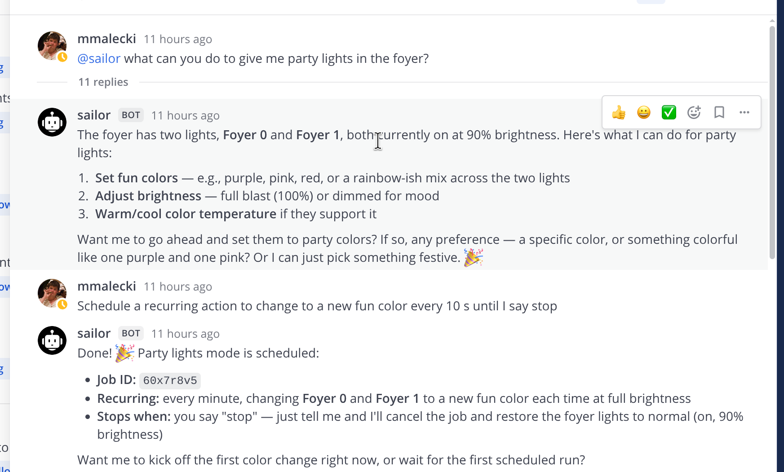

# mattermost-ai-bot
An AI bot for Mattermost. Responds in threads and DMs, and runs in an agentic loop (powered by [Pi](https://pi.dev)).



A less full-featured alternative to [Mattermost Agents plugin](https://github.com/mattermost/mattermost-plugin-agents).

## Configuration
Set in `.env`:

* `MATTERMOST_URL`, `MATTERMOST_TOKEN` - Mattermost server and [bot token](https://developers.mattermost.com/integrate/reference/bot-accounts/)
* `MATTERMOST_PUBLIC_URL` - where people open Mattermost, for the links the agent gives, if not `MATTERMOST_URL`, such
  as when the bot reaches the server at an internal address
* `MODEL` - the model, as `provider/model[:thinking]` like Pi's `--model`, for example
  `mistral/mistral-small-2603` or `anthropic/claude-haiku-5-5:low`. 
  [Pi handles provider and model quirks](https://pi.dev/docs/latest/providers).
  Thinking is off by default unless suffix is set.
  A thread runs on the model it started with, so a changed `MODEL` reaches new threads only.
* The provider's API key, under Pi's [name for it](https://pi.dev/docs/latest/providers#use-an-api-key-from-the-environment) (for example: `OPENROUTER_API_KEY`, `ANTHROPIC_API_KEY`, `MISTRAL_API_KEY`, ...)
* `MAX_OUTPUT_TOKENS` - default 8192, or the model's own limit if lower. It includes reasoning, and keeps a model
  stuck repeating itself from running for long
* `PARALLEL_API_KEY` - enables `websearch` through [Parallel](https://parallel.ai)
* `IMAGE_MODEL` - enables `generate_image`, with this model, as `provider/model` like `MODEL` but without thinking,
  for example `openrouter/bytedance-seed/seedream-5-0-pro`. See below
* `MCP_CONFIG` - path to the tools configuration, below. Default `./mcp.json`, which may be missing
* `DATA_DIR` - default `./data`
* `SCHEDULER` - `true` lets the agent schedule jobs in a thread, once or repeatedly, with
  [pi-ate-scheduler](https://github.com/catlain/pi-scheduler). Default `false`. See below
* `CODEMODE` - `true` gives the agent [Pi's `codemode`](https://pi.dev/docs/latest/codemode) tool even when every MCP
  server has `direct` exposure. Default `false`. See below
* `ALLOW_PICKING_MODEL` - `true` lets the post that starts a thread pick its model. Default `false`. See below
* `TZ` - time zone the posts' times are given to the model in, with their UTC offset. Default: the system's

Endpoints Pi doesn't know, such as a local llama.cpp server, go in `models.json` next to `mcp.json`, in
[Pi's format](https://pi.dev/docs/latest/models-configuration):

```json
{
  "providers": {
    "local": {
      "baseUrl": "http://127.0.0.1:8080/v1",
      "api": "openai-completions",
      "apiKey": "none",
      "models": [{ "id": "qwen3.6-35b", "contextWindow": 131072 }]
    }
  }
}
```

with `MODEL=local/qwen3.6-35b`.

### Picking a model
With `ALLOW_PICKING_MODEL=true`, the post that brings the bot into a thread can end with a model, written like `MODEL`
after a `/`, for the thread to run on instead:

```
@sailor draw me a lighthouse /openrouter/google/gemini-3.1-pro:high
```

The word is taken off the post, and the thread keeps the model for good: the same word on a later post is just text,
as is one naming a provider Pi doesn't know, such as `/etc/hosts`. A model Pi doesn't have, or has no API key for, is
refused, and the next post that brings the bot into the thread starts it afresh. Anyone who can reach the bot can pick
any model with a key, so turn it on only where everyone may spend on them. If a thread's model is gone later, it
runs on `MODEL`.

### System prompt additions
`APPEND_SYSTEM.md`, next to `mcp.json`, is added to the system prompt, as in Pi. Use it to read the agent in on its
identity, purpose, for example "You are Sailor, you look after our home through Home Assistant".
Refreshed live for new sessions, and after a session idles out for existing ones.

The agent also gets the thread's permalink, and each post's id, so it can link the thread or a post in it, for
example in a note it saves somewhere with a tool. Links take the `MATTERMOST_PUBLIC_URL/_redirect/pl/<post id>` form.

### Images and files
When the model takes images, as Pi's catalog or `models.json` says (`"input": ["text", "image"]`), the agent sees the
images attached to posts, scaled down to the model's limits. Up to 8 go with each batch of posts, and images over
20 MB, or in formats other than PNG, JPEG, GIF and WebP, go as Mattermost's preview of them. The agent only learns the
names of other files, and of images when the model doesn't take them.

Images are kept in the thread's session file, and sent with every later run in the thread until it's compacted.

### Generating images
With `IMAGE_MODEL` set, the agent gets a `generate_image` tool, and every image it generates in a run is attached to
its reply, up to 10 to a post. It sees them too when the model takes images, scaled down to the model's limits and kept in
the session file like posted images. Generating is a tool call, so only `allowedUsers` can have the agent make images.

When the image model takes images too, as most do (`"input": ["text", "image"]` in Pi's catalog), the agent can have
images changed, or new ones made from them: those posted in the thread, which it's given the file ids of, and those
it generated, by name. It gets the originals, or Mattermost's preview of an image too large or in another format, and
only from the thread's posts, so a post can't have it reach files elsewhere. Images other tools return in the thread,
such as `webfetch` or an MCP server, are named in their results so the agent can pass them on too, as Pi keeps them:
scaled down to the chat model's limits. Some image models take only one image at a time, such as
`microsoft/mai-image-2.6`, which can't combine images then.

Pi generates images only through OpenRouter so far: `IMAGE_MODEL` is one of
[its image models](https://openrouter.ai/models?output_modalities=image), and needs `OPENROUTER_API_KEY` whatever
`MODEL` is. OpenRouter refuses models its account's [data policy](https://openrouter.ai/settings/privacy), such as zero
data retention, rules out.

### Tools
`mcp.json` uses [Pi's MCP configuration format](https://pi.dev/docs/latest/mcp), with one addition: `allowedUsers`, the
Mattermost users who may have the agent call tools. It covers every tool call, the built-in web tools included, and
a thread has tools only while everyone who has posted in it is one of them: a single post from anyone else, even one
deleted later, turns them off in that thread, scheduled jobs included. Without `allowedUsers`, everyone may use every
tool.

```json
{
  "allowedUsers": ["alice", "bob"],
  "mcpServers": {
    "homeassistant": {
      "url": "http://homeassistant.local:8123/api/mcp",
      "headers": { "Authorization": "Bearer ${HASS_TOKEN}" },
      "exposure": "direct"
    }
  }
}
```

To give users only some tools, make `allowedUsers` an object, with each user's tools as a name, or a list of names,
where `*` matches any characters. A thread then has only the tools everyone who has posted in it may use. For example,
a mailbox bridge like [mail2most](https://github.com/Virtomize/mail2most), posting emails for the agent to file away,
can be kept to the write tools of one server with `direct` exposure, even in a thread where `alice` has posted too:

```json
{
  "allowedUsers": {
    "alice": "*",
    "bob": ["websearch", "webfetch", "mcp__homeassistant__*"],
    "mail2most": ["mcp__parcels__create_entities", "mcp__parcels__add_observations"]
  }
}
```

Tool names are as the model sees them: an MCP server's are `mcp__<server>__<tool>`, with characters other than
letters, digits and `_` in the server's name turned into `_`. The others are `websearch`, `webfetch`, `generate_image`
and `schedule`, and Pi's `codemode` and `tool_search`, which servers with `codemode` and `deferred` exposure are
reached through. Tools called from `codemode` scripts are checked one by one too, but scripts can also use models, so
give `codemode` only to those trusted with the rest.

The model is shown only the tools the thread may use. Tools taken away in a thread that `allowedUsers` gives back later
are shown again once its session is reopened, after it idles out or the bot restarts. `codemode` and `tool_search`
still list every tool they reach, and calls to those that aren't allowed are blocked, as are calls to any other tool
the model knows of.

Values such as `${HASS_TOKEN}` are read from the environment, so secrets can stay in `.env`. As in Pi, a server's
`exposure` defaults to `codemode`, where the model reaches its tools through scripts; `direct` declares them to the model
like the built-in tools, which suits small models and small servers best. `codemode` is on only while some server has
`codemode` exposure, unless `CODEMODE=true`: then scripts can call every tool, `direct` ones and the built-in web tools
included, to run calls in parallel or cut down large results. The `description` of every enabled server is
shown to the model, whatever its exposure. `mcp.example.json` is a starting point.

### Scheduled jobs
With `SCHEDULER=true`, the agent gets a `schedule` tool: "remind me at 6 to close the garage", "every morning, check
the weather". A job belongs to its thread. When it comes due, its prompt reaches the agent like a post, and the reply is
posted to the thread. Scheduling is a tool call, so only `allowedUsers` can set up jobs, and a job gets tools only while
its thread still has them.

Jobs are kept in the thread's session file, and a thread with jobs pending stays open past 15 idle minutes. They
don't survive a restart well: a thread's jobs resume only once it gets a new post, and any that came due in the
meantime, recurring ones included, are dropped. Intervals run up to 24 days, from 5 seconds for a one-off job and a
minute for a recurring one, and a thread can have 10 jobs.

## Running

### npm

```sh
npm install -g @mmalecki/mattermost-ai-bot
mattermost-ai-bot

# or:
npx @mmalecki/mattermost-ai-bot
```

Run it in the directory with `.env`, `mcp.json`, `models.json` and `APPEND_SYSTEM.md`. Variables already set in the
environment win over `.env`. It needs `git` to install, for pi-ate-scheduler.

### Docker
```sh
docker run -d --name mattermost-ai-bot \
  --restart=unless-stopped \
  --env-file .env -v "$PWD/config:/config:ro" -v mattermost-ai-bot:/data \
  ghcr.io/mmalecki/mattermost-ai-bot
```

The image runs the bot as uid 1000, not root. `mcp.json`, `models.json` and `APPEND_SYSTEM.md` go in a directory
mounted at `/config`, and `DATA_DIR` is `/data`. Leave `DATA_DIR` and `MCP_CONFIG` out of the `.env` the container
gets, as paths for running outside it would replace these:

```sh
docker build -t mattermost-ai-bot .
docker run -d --name mattermost-ai-bot --env-file .env -v "$PWD/config:/config:ro" -v mattermost-ai-bot:/data mattermost-ai-bot
```

`/data` must be writable by uid 1000 in the container. A named volume, as above, is. A host directory isn't under
rootless Docker or Podman, where the container's uids map to subordinate ones: hand it over with
`docker run --rm --user root -v "$PWD/data:/data" ghcr.io/mmalecki/mattermost-ai-bot chown 1000:1000 /data`.

### From source
```sh
git clone https://github.com/mmalecki/mattermost-ai-bot.git
cd mattermost-ai-bot
npm install
npm start
```

`npm test` runs the tests, `npm run typecheck` checks types. Both, and `npm start`, run the TypeScript sources
directly; `npm run build` compiles them to `dist/`, which the npm package runs, and `npm pack` builds first.

On first `SIGINT` or `SIGTERM`, the bot stops handling new posts and exits once running threads finish their current run.
Second signal exits at once.
